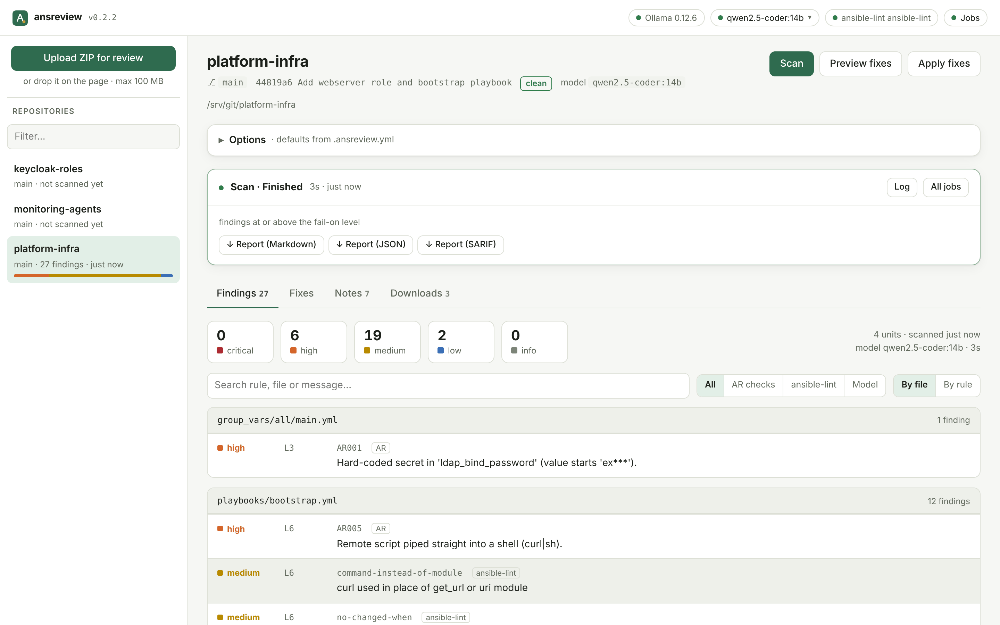
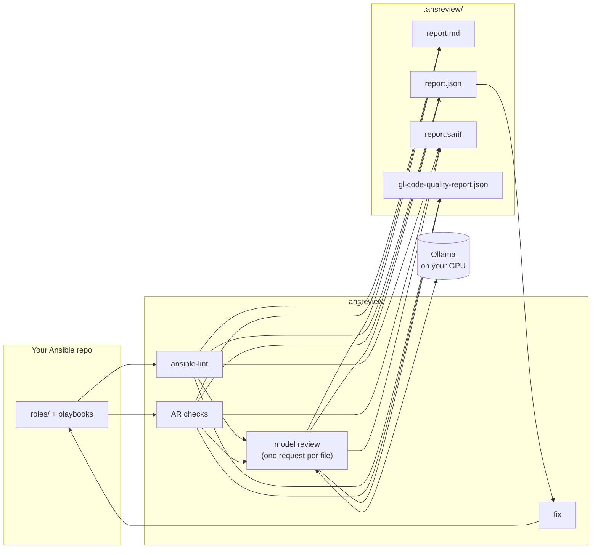

# ansreview

**Review an Ansible codebase on your own hardware.** ansible-lint, built-in
security checks and a local Ollama model look at every role and playbook, and
the findings come out as Markdown, JSON, SARIF and GitLab Code Quality.

No code leaves your network: the model runs on your own Ollama server.

-   :material-rocket-launch: **[Quick start](getting-started/quickstart.md)**

    Install, pull a model, run `ansreview` in your repo.

-   :material-auto-fix: **[Automatic fixes](usage/fix.md)**

    Let the model, the built-in fixers and `ansible-lint --fix` repair what the scan found.
    Nothing is committed.

-   :material-monitor-dashboard: **[Web UI](usage/web-ui.md)**

    Scan, browse findings, preview and apply fixes, upload a ZIP, from the browser.

-   :material-gitlab: **[GitLab merge requests](usage/merge-requests.md)**

    Review every new commit on open merge requests, with one comment per MR. No CI change needed.

[{ loading=lazy }](assets/screenshots/findings.png)

## Three layers

| Layer | What it finds |
|---|---|
| **ansible-lint** | Best practices, FQCN, syntax and idempotency rules |
| **Built-in checks (AR0xx)** | Security problems linters miss: hard-coded secrets, missing `no_log`, `curl` piped into `sh`, world-writable modes, disabled TLS validation, SELinux/firewalld switched off, weak sshd settings, credentials in URLs, committed private keys. See [Built-in rules](reference/rules.md) |
| **A local Ollama model** | Logic errors, broken handlers, unsafe shell, idempotency problems and anything else the first two layers miss. It is told what the linters already found, so it looks for new problems |

## How it fits together

## Ways to run it

| How | Where it's described |
|---|---|
| CLI on your laptop or a GPU box | [Scan](usage/scan.md), [Automatic fixes](usage/fix.md) |
| Web UI for a folder of repos | [Web UI](usage/web-ui.md) |
| Container (`ghcr.io/jwklijnsma/ansreview`) | [Docker](deploy/docker.md) |
| Service that starts at boot | [systemd service](deploy/systemd.md) |
| Merge-request reviewer that polls GitLab | [GitLab merge requests](usage/merge-requests.md) |
| CI job or pre-commit hook | [CI and pre-commit](deploy/ci.md) |

!!! tip "Sibling projects"
    [helmreview](https://jwklijnsma.github.io/helmreview/) does the same for Helm
    charts and Kubernetes manifests, and
    [docpipe](https://jwklijnsma.github.io/docpipe/) writes documentation from the
    same kind of repositories with the same Ollama server.
