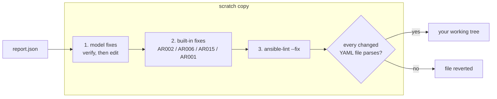

# Automatic fixes

```bash
ansreview fix ~/git/infra                       # uses .ansreview/report.json from your last scan
ansreview fix ~/git/infra --dry-run             # only write .ansreview/fix.patch
ansreview fix ~/git/infra --only roles/keycloak # one role
ansreview fix ~/git/infra --vault-password-file ~/.vault-pass   # also vault hard-coded secrets
```

`fix` reads `.ansreview/report.json` (or `--from-report FILE`). When there is no
report yet, it runs a scan first.

## Three stages

`fix` works in a scratch copy of the repo.



### 1. Model fixes

For every model finding at or above `medium` with a confidence of at least
`0.8`, the model first checks whether the finding is real. False positives,
such as `inventory_hostname` in `command:` flagged as injection, are
**declined**. Real findings get minimal, exact search/replace edits.

An edit is rejected when it:

- does not match the file exactly once;
- breaks the YAML;
- rewrites too much of the file.

Change the thresholds with `--min-severity` / `--min-confidence`, or
`fix_min_severity` / `fix_min_confidence` in the config.

### 2. Built-in fixes

These are deterministic and use fresh line numbers:

| Rule | Fix |
|---|---|
| AR002, AR015 | Add `no_log: true` |
| AR006 | World-writable modes become `0644`, or `0755` for directories |
| AR001 | Hard-coded secrets are encrypted in place with ansible-vault, only when you pass `--vault-password-file` |

Risky changes, such as sshd settings, SELinux, http→https and checksums, are
listed under **Needs a human** and left alone. `--no-static-fix` skips this stage.

!!! warning "Rotate vaulted secrets"
    Vaulting a secret does not remove it from git history. Rotate it.

### 3. ansible-lint --fix

For mechanical rules: FQCN, free-form arguments, name casing and YAML
formatting. Comments are kept. Limit it with `--lint-fix-rules fqcn,name`, or
skip it with `--no-lint-fix`.

## What you get

Every changed YAML file must still parse, or it is reverted. Results are
written to your working tree but **never committed**.

| File | Contents |
|---|---|
| `git diff` | What changed. Undo with `git checkout -- .` |
| `.ansreview/fix-report.md` | What was fixed, declined, failed or needs a human |
| `.ansreview/fix.patch` | The diff, also with `--dry-run` |

`fix` refuses to run on a repo with uncommitted changes, so the diff only ever
shows ansreview's work. Override with `--allow-dirty`.

## Speed

- **One request per file** with all of its findings. Set `fix_batch_size`
  (`--batch-size`) to cap the number of findings per request.
- **Excerpts for long files.** Files longer than `fix_full_file_lines` (120) are
  sent as excerpts of `fix_context_lines` (25) around each finding, which cuts
  prompt time on big playbooks.
- **Streaming.** `timeout` is the longest the model may stay silent, not the total time.
- **Split on timeout.** A batch that times out is split in half and tried again;
  it is never resent unchanged.
- **Cache.** Answers and timeouts are cached in `.ansreview/fix-cache.json`, so a
  re-run only asks about files that changed. `--no-cache` asks again.
- **A smaller model** is often good enough: `ansreview fix --model qwen2.5-coder:7b`
  is about twice as fast, and every edit is verified anyway.
