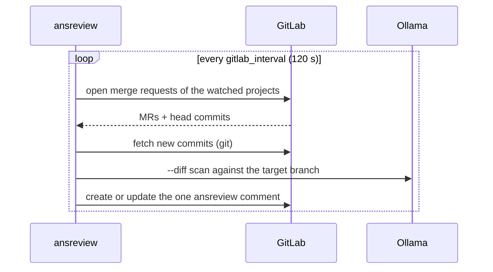

# GitLab merge requests

Instead of adding a CI job to every repository, let ansreview fetch the merge
requests itself. It asks GitLab for open merge requests every two minutes, runs
a [`--diff` scan](scan.md#diff-mode) against the target branch for each new
commit, and keeps **one comment** per merge request up to date with the
findings on the changed lines.



## Run it

```bash
export GITLAB_TOKEN=glpat-…                 # scope: api
ansreview watch-mrs --gitlab-url https://gitlab.example.nl \
    --project platform/infra --group platform/ansible     # runs until Ctrl-C
ansreview watch-mrs … --dry-run             # only list what would be reviewed
ansreview watch-mrs … --once                # one round, then exit (cron or a scheduled pipeline)
ansreview serve --root ~/git --watch-mrs    # the web UI and the watcher in one process
```

With `serve --watch-mrs` (or `ANSREVIEW_WATCH_MRS=1` for the container),
merge-request scans wait their turn behind the jobs started in the UI and use
the model picked there. They do not show up in the Jobs list; follow them in
the log.

## Settings

| Setting (`~/.ansreview.yml`) | Environment | Default | |
|---|---|---|---|
| `gitlab_url` | `ANSREVIEW_GITLAB_URL` | – | `--gitlab-url` |
| `gitlab_projects` | `ANSREVIEW_GITLAB_PROJECTS` (comma-separated) | – | `--project`, path or id |
| `gitlab_groups` | `ANSREVIEW_GITLAB_GROUPS` | – | `--group`; includes subgroups |
| `gitlab_token_env` | `ANSREVIEW_GITLAB_TOKEN_ENV` | `GITLAB_TOKEN` | name of the variable that holds the token |
| `gitlab_interval` | `ANSREVIEW_GITLAB_INTERVAL` | `120` | seconds between polls (`--interval`) |
| `gitlab_skip_drafts` / `gitlab_skip_forks` | `ANSREVIEW_GITLAB_SKIP_DRAFTS` / `…_SKIP_FORKS` | `false` | `--skip-drafts` / `--skip-forks` |
| `gitlab_max_age_days` | – | `14` | merge requests untouched for longer are left alone (`0` = all) |

## Good to know

- **As a scheduled pipeline.** `examples/gitlab-ci.yml` has a ready job: one
  project with a pipeline schedule reviews the merge requests of all the others.
  See [CI and pre-commit](../deploy/ci.md#one-central-job-for-all-merge-requests).
- **Token.** A project or group access token with the `api` scope and the
  Reporter role is enough (it reads the repository and writes a comment). It is
  only ever read from the environment and is not written to the checkout's git
  config.
- **Polling, not a webhook.** Only outgoing HTTPS to GitLab is needed, so this
  works from a GPU box GitLab cannot reach. With an internal CA, set
  `REQUESTS_CA_BUNDLE` and `GIT_SSL_CAINFO` to your CA bundle.
- **State.** Checkouts and the list of reviewed commits live in
  `~/.cache/ansreview/mr` (`--state-dir`; inside the data volume in the
  container). The reviewed commit is also stored in the comment, so an empty
  state folder does not cause a second review.
- **Quiet when there is nothing to say.** A merge request that changes nothing
  ansreview reviews gets no comment. A scan that fails is tried three times.

!!! warning "Whose code runs"
    ansible-lint runs on the merge request's code, as it would in CI. Watch only
    projects whose contributors you would let run ansible-lint on this host, and
    consider `--skip-forks`. Settings come from `~/.ansreview.yml`, the
    environment and flags; a repository cannot change the GitLab URL, the
    projects or the Ollama host.
