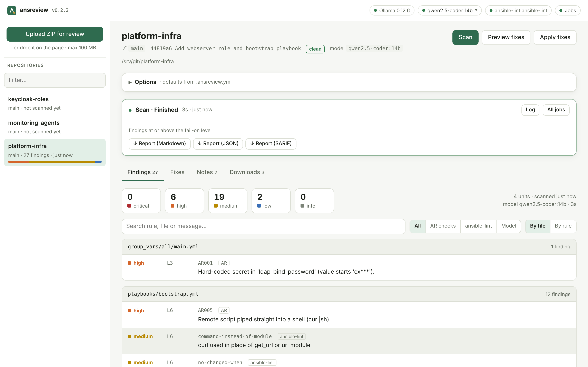
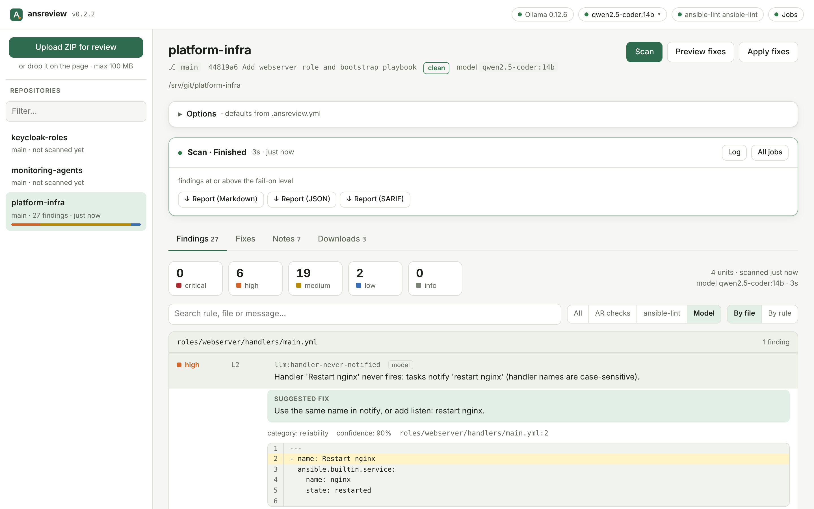
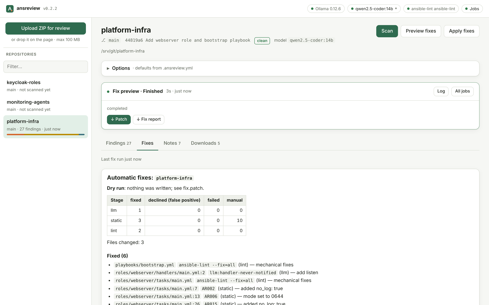
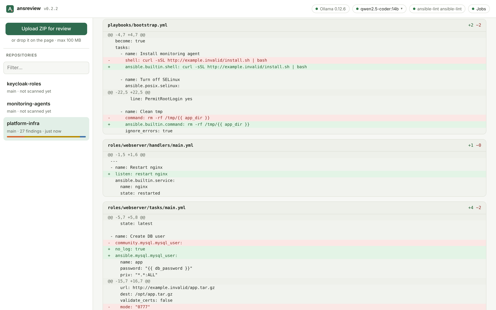
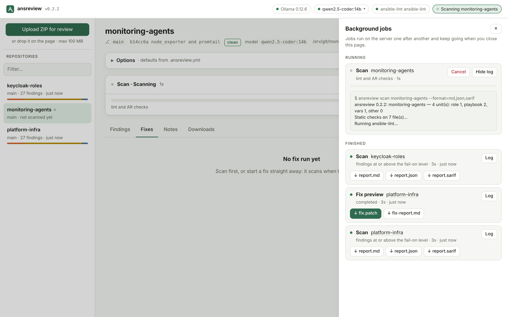

# Web UI

```bash
ansreview serve --root ~/git                    # a folder of repos (or one repo)
ansreview serve --root ~/git/infra --root ~/git/platform --open
```

It prints a link with an access token (`http://localhost:8765/?token=…`). Open
it once; the token becomes a cookie.

[{ loading=lazy }](../assets/screenshots/findings.png)

## What you can do

- **Scan** a repository, with the same options as the CLI: diff mode, only some
  roles, model override, skip the model, lint profile.
- **Run in the background.** Scans and fixes go into a queue on the server and
  keep running when you close the page. The **Jobs** button in the top bar
  shows what is running, what is waiting (with its place in the queue) and what
  finished, with progress, the log, Cancel/Remove, and download buttons.
- **Pick the model** in the top bar from the models your Ollama has (or type
  one). It applies to every new scan and fix and survives restarts (saved in
  `~/.cache/ansreview/settings.json`). A model set in a repo's Options still
  wins for that repo.
- **Browse findings** by severity, source (AR / ansible-lint / model) or rule,
  with the suggested fix and the code around each line.
- **Preview fixes** (`fix --dry-run`), read the fix report and the colour diff,
  then **Apply fixes**. Nothing is ever committed; review with `git diff` as usual.
- **Upload a ZIP** of an Ansible repo (button or drag and drop). It is unpacked
  and its scan is queued straight away. **Fix & download** fixes it in the
  background; when it is done you get a notification with the fixed ZIP. A
  GitHub "Download ZIP" works as-is.
- **Download** the results: every finished job offers its files (fixed ZIP,
  `fix.patch`, fix report, report as Markdown, JSON or SARIF), and each repo has
  a **Downloads** tab with the latest ones.

=== "A model finding"

    [{ loading=lazy }](../assets/screenshots/finding-detail.png)

=== "Fix preview"

    [{ loading=lazy }](../assets/screenshots/fixes.png)

=== "Diff"

    [{ loading=lazy }](../assets/screenshots/fix-diff.png)

=== "Background jobs"

    [{ loading=lazy }](../assets/screenshots/jobs.png)

## How jobs run

Scans and fixes run as `ansreview scan|fix` subprocesses, so they behave exactly
like the CLI and write the same `.ansreview/` reports. Jobs run one at a time,
in order, since they share the GPU; up to 20 can wait. The job list lives in the
server process, so a restart of `ansreview serve` forgets it (the reports on
disk stay).

With `--watch-mrs`, the same process also reviews GitLab merge requests. See
[GitLab merge requests](merge-requests.md).

The UI is a React app built into the Python package, so a normal install needs
no Node and nothing is loaded from a CDN: it works on an air-gapped host.

## Uploads

| Setting | Default |
|---|---|
| Folder | `~/.cache/ansreview/uploads` (`--upload-dir`) |
| Largest ZIP | 100 MB (`--max-upload-mb`) |
| Kept for | 7 days (`--upload-keep-days`, `0` = keep), or the Delete button |
| Off | `--no-upload` |

Each upload becomes its own small git repository, so `fix` works on it.
Extraction refuses paths that leave the folder, skips symlinks and any `.git`,
and stops ZIP bombs: size, file count and compression ratio are checked on the
bytes actually written.

!!! warning "Uploaded code runs ansible-lint"
    ansible-lint runs on the uploaded code just as on a repo under `--root`. Only
    share the token with people you would let run ansible-lint on this host.

## Security

- It listens on `127.0.0.1` by default, and every API call needs the token.
  Set a fixed one with `--token` or `$ANSREVIEW_WEB_TOKEN`; otherwise you get a
  random one at every start.
- Only repositories under the `--root` folders are reachable, and file reads
  cannot leave a repo.
- The Ollama host, output folder, config file and vault password file cannot be
  set from the browser.
- POSTs need a custom header, so other sites cannot trigger a scan.
- `--no-auth` is refused unless you bind to localhost.

To reach it from another machine, prefer an SSH tunnel:

```bash
ssh -L 8765:localhost:8765 gpu-box
```

If you do use `--bind 0.0.0.0`, put it behind a TLS reverse proxy, because the
token travels in plain HTTP otherwise.

To run the UI as a service, see [Docker](../deploy/docker.md) and
[systemd service](../deploy/systemd.md).
